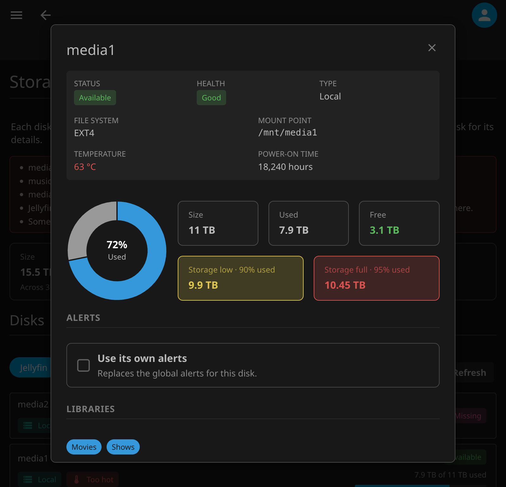
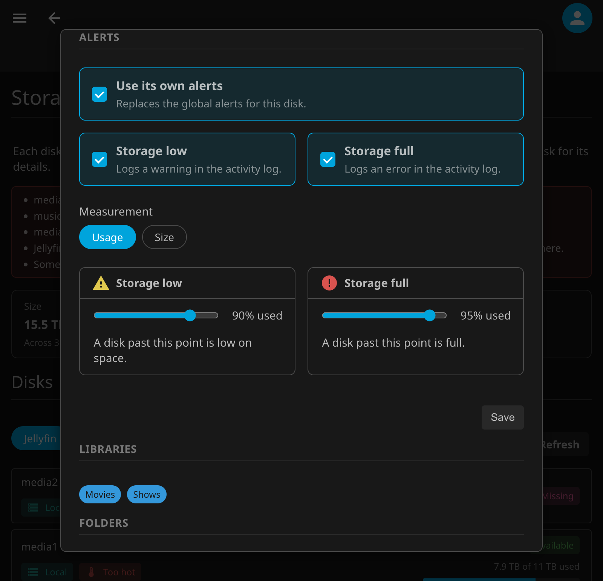
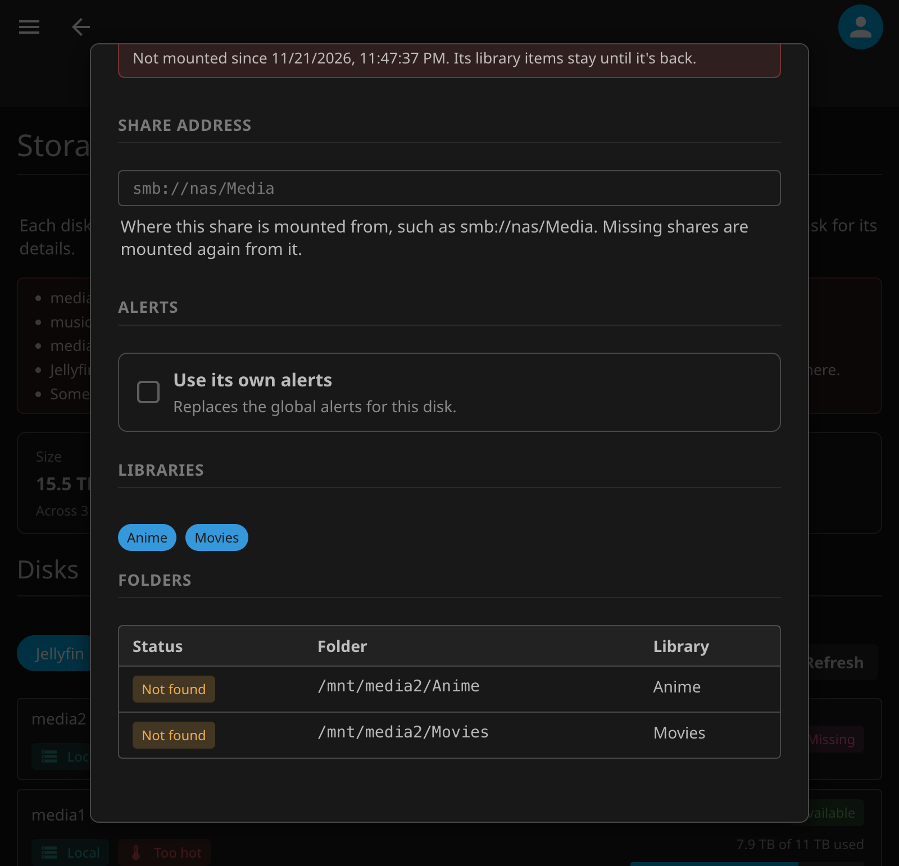
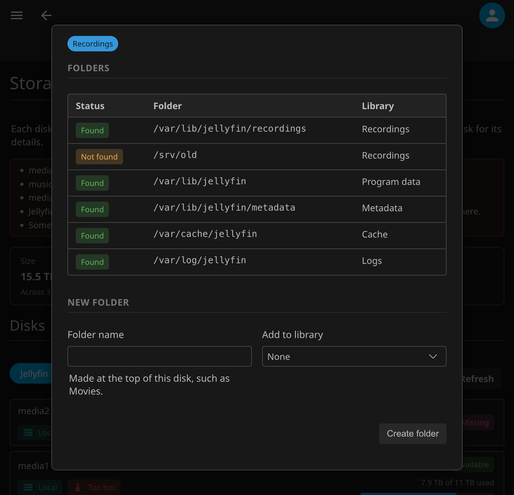
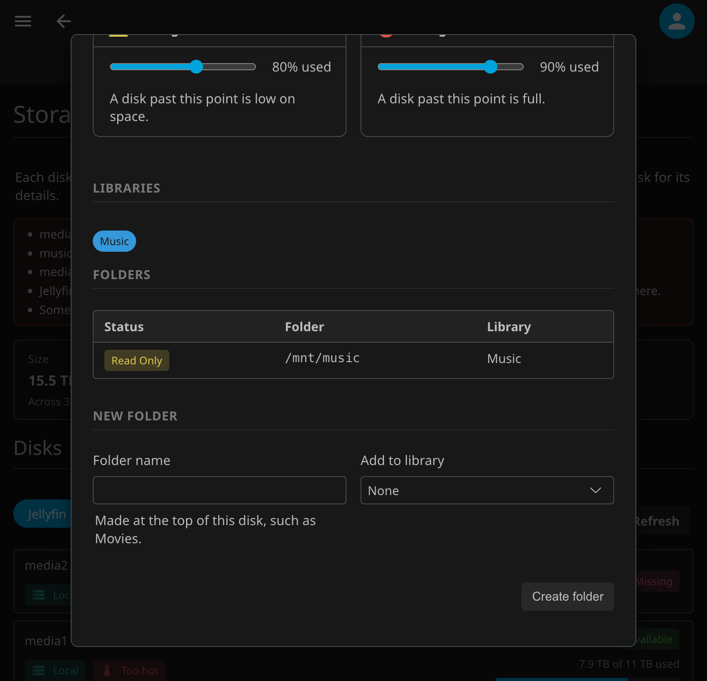

# Disk details

Select a disk on the **Storage** tab to open it. The dialog shows what the disk is, its space, its alerts, and the folders Jellyfin keeps on it.

## Facts

The top of the dialog lists the disk's status, type, file system, mount point, device, and model. A disk that reports SMART data also shows its health, temperature, power-on time, and, for an SSD, its wear.

| Fact | Color |
| :--- | :--- |
| **Health** | Green for **Good**, red for **Failing** |
| **Temperature** | Red past the **Too hot** alert |
| **Wear** | Green below half its rated life, yellow past half, red past the **Worn out** alert |

A share has no SMART data, so it shows none. See [Installation](Installation.md) for which disks report it on each OS.

## Space

The chart shows the share of the disk in use. The **Size**, **Used**, and **Free** cards beside it give the amounts. **Storage low** and **Storage full** show how much space is in use when each alert fires on this disk, such as 9.9 TB for 90% of an 11 TB disk. A card is left out when its alert is off.

## Alerts

A disk uses the global alerts from the **Settings** tab unless it has its own. Check **Use its own alerts** to set this disk's **Storage low** and **Storage full** alerts, then select **Save**. Clear it and select **Save** to use the global alerts again.

## Share address

A share, and a disk that is missing, shows its **Share address**: where it is mounted from, such as `smb://nas.example.com/Media`. Storage fills it in whenever it sees the share mounted. Set it by hand for a share that was already gone when Storage was installed, then select **Save**. A missing share is mounted again from it at the next check. See [Missing disks](MissingDisks.md).

## Libraries and folders

**Libraries** lists each library with a folder on the disk. **Folders** lists every library folder and Jellyfin folder on it.

| Status | Meaning |
| :--- | :--- |
| **Found** | The folder is there, and Jellyfin can write to it. |
| **Not found** | The folder is gone, or its disk is missing. |
| **Read Only** | The folder is there, but Jellyfin cannot write to it. NFO files and artwork saved next to the media fail there. |

Jellyfin's own folders show under the names the dashboard gives them: **Program data**, **Web**, **Logs**, **Image cache**, **Metadata**, **Cache**, and **Transcodes**. Each one puts its disk in use, so it is alerted on and remounted like a library disk. They never block a library scan.

To make a folder on the disk, see [New folder](Formatting.md#new-folder).

Next: [Formatting and folders](Formatting.md).
