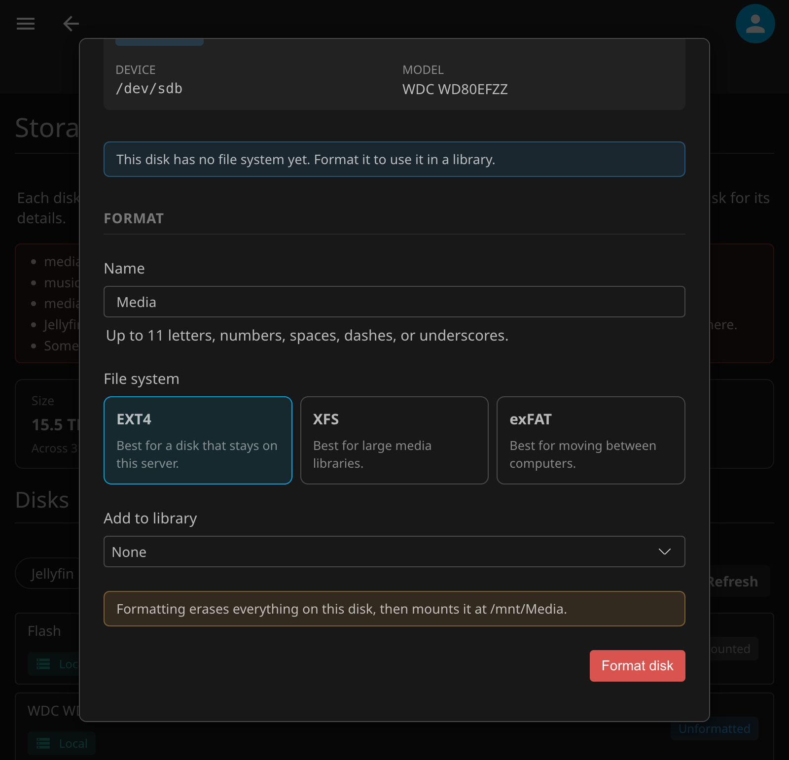
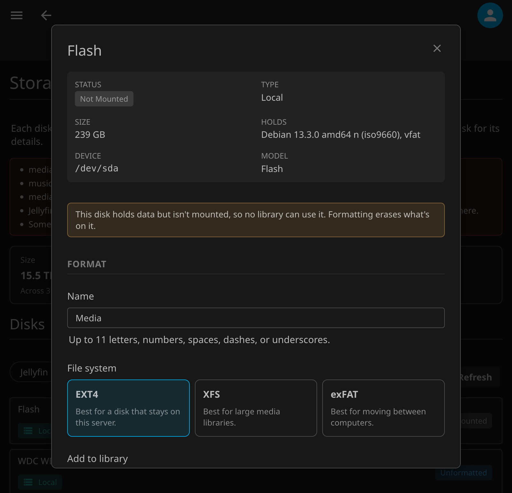
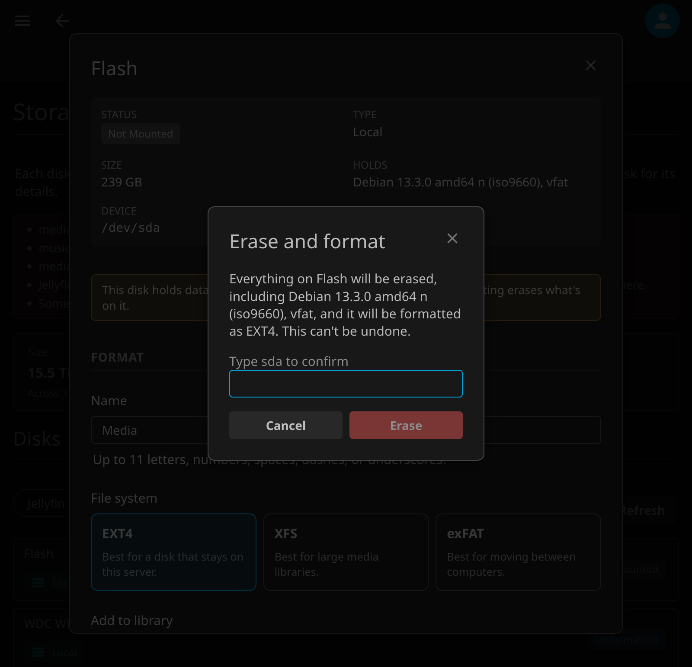
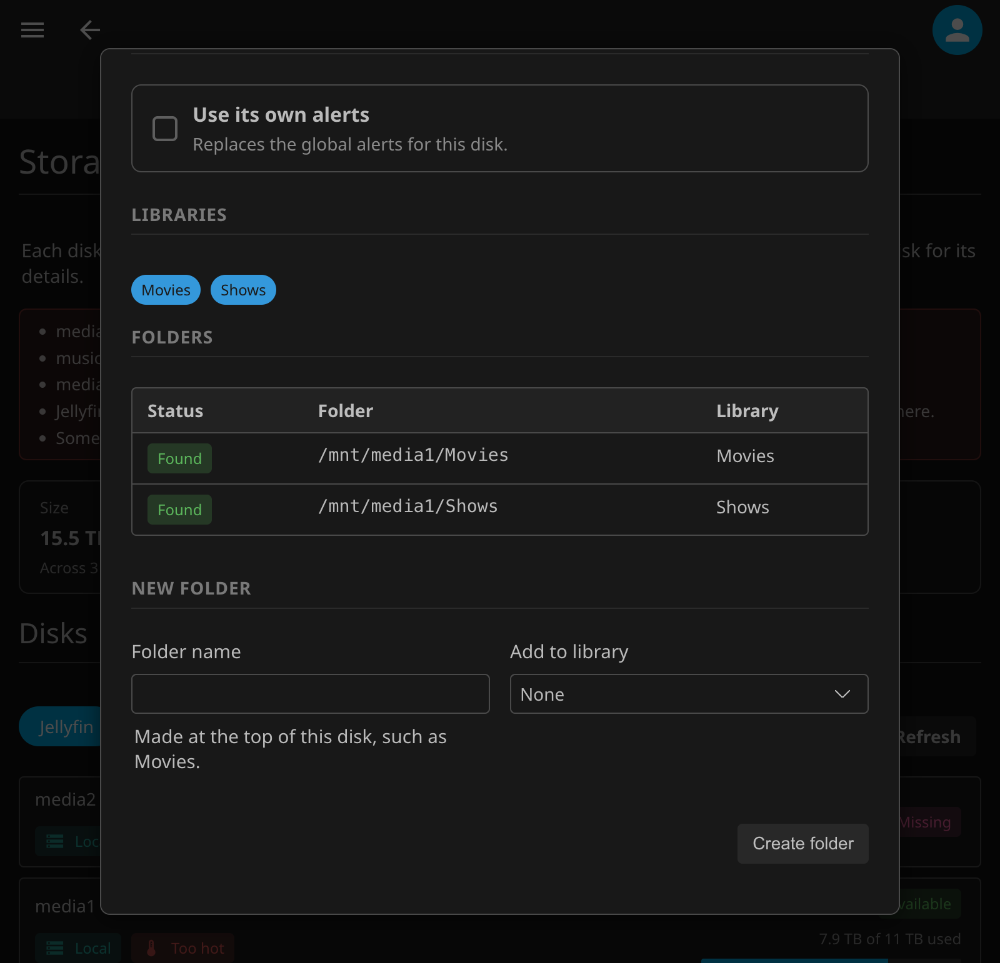

# Formatting and folders

Storage formats a new disk, mounts it where it stays mounted after a restart, and adds it to a library in one step. It also makes folders on a mounted disk.

## Format a blank disk

A disk with no file system shows as **Unformatted** under **All** on the **Storage** tab. Open it to format it.

1. Enter a **Name** for the disk, such as `Media`. Use up to 11 letters, numbers, spaces, dashes, or underscores, starting with a letter or number.
2. Select a **File system**. Each card says what it is best for.
3. Select a library under **Add to library** to add the new disk to it, or leave **None**.
4. Select **Format disk**.
5. Type the disk's new name to confirm, then select **Format**.

The line above **Format disk** says where the disk will be mounted. When the format finishes, the dialog closes and the disk shows as **Available**.

!!! warning
    Formatting erases everything on the disk. It cannot be undone.

## Erase a disk that holds data

On Linux, a disk that holds data but has nothing mounted, such as a USB drive with an installer on it, shows as **Not Mounted**. Its dialog lists what it **Holds**, such as `Debian 13 (iso9660), vfat`.

Its form reads **Erase and format**. To confirm, type the disk's device name, such as `sda`, rather than its new name. The confirmation names what is erased.

A disk that `/etc/fstab` mounts where a library expects a disk is that library's disk, dropped off. Its dialog says so and offers no format. Mount it again instead. See [Missing disks](MissingDisks.md).

## File systems

| File system | Best for | Offered on |
| :--- | :--- | :--- |
| **EXT4** | A disk that stays on this server | Linux |
| **XFS** | Large media libraries | Linux |
| **Btrfs** | Snapshots and checksums | Linux |
| **exFAT** | Moving between computers | Linux, macOS, Windows |
| **NTFS** | Windows | Linux, Windows |
| **APFS** | macOS | macOS |

On Linux, the form offers each file system udisks2 has the tools to make. See [Installation](Installation.md#file-systems).

## Where a new disk goes

| OS | Mounted at | After a restart |
| :--- | :--- | :--- |
| Linux | `/mnt/<name>`, with dashes for spaces | An `/etc/fstab` entry by UUID mounts it, and it can be remounted |
| macOS | `/Volumes/<name>` | macOS mounts it when it is plugged in |
| Windows | The next free drive letter | Windows mounts it |

On Linux, a disk formatted as ext4, XFS, or Btrfs belongs to Jellyfin's user. exFAT and NTFS keep no Linux owners, so their `/etc/fstab` entry names Jellyfin's user and group, and Jellyfin can write to them after every restart.

## What Storage never formats

* The system disk, or any disk with something on it mounted or in use as swap.
* A disk something is stacked on, such as LVM, RAID, or an encrypted volume.
* A disk that holds data, unless the request says to erase it.
* A disk whose folder another disk already uses, such as a library's mount point or another `/etc/fstab` entry.

Storage checks the disk again the moment the format starts, not only when the dialog opened. One format runs at a time.

## New folder

A mounted disk's dialog has a **New folder** form. It makes a folder at the top of the disk and can add it to a library, such as `Movies` on a disk just formatted.

1. Enter a **Folder name**, such as `Movies`.
2. Select a library under **Add to library**, or leave **None**.
3. Select **Create folder**.

The folder is made as Jellyfin's own user. A folder that is already there is left alone. On a disk Jellyfin cannot write to, the form shows the reason the OS gives.

Next: [Settings](Settings.md).
