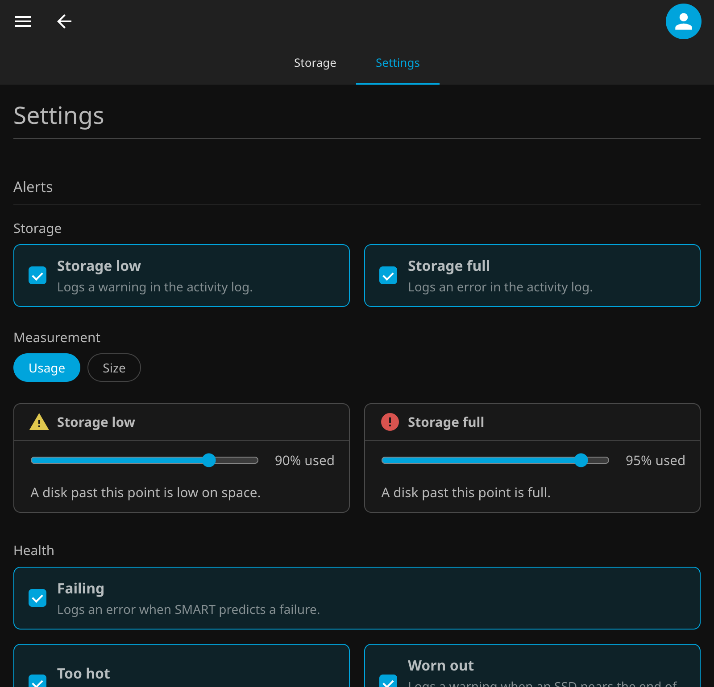
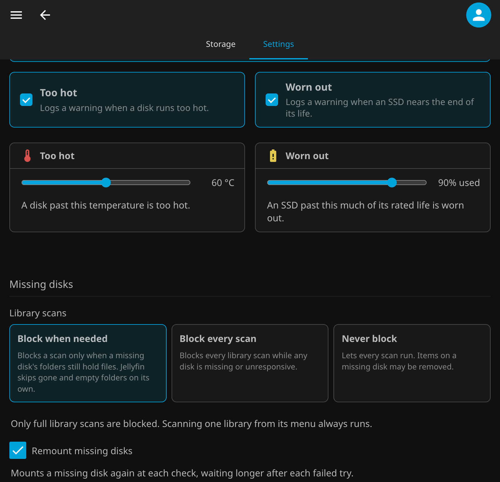
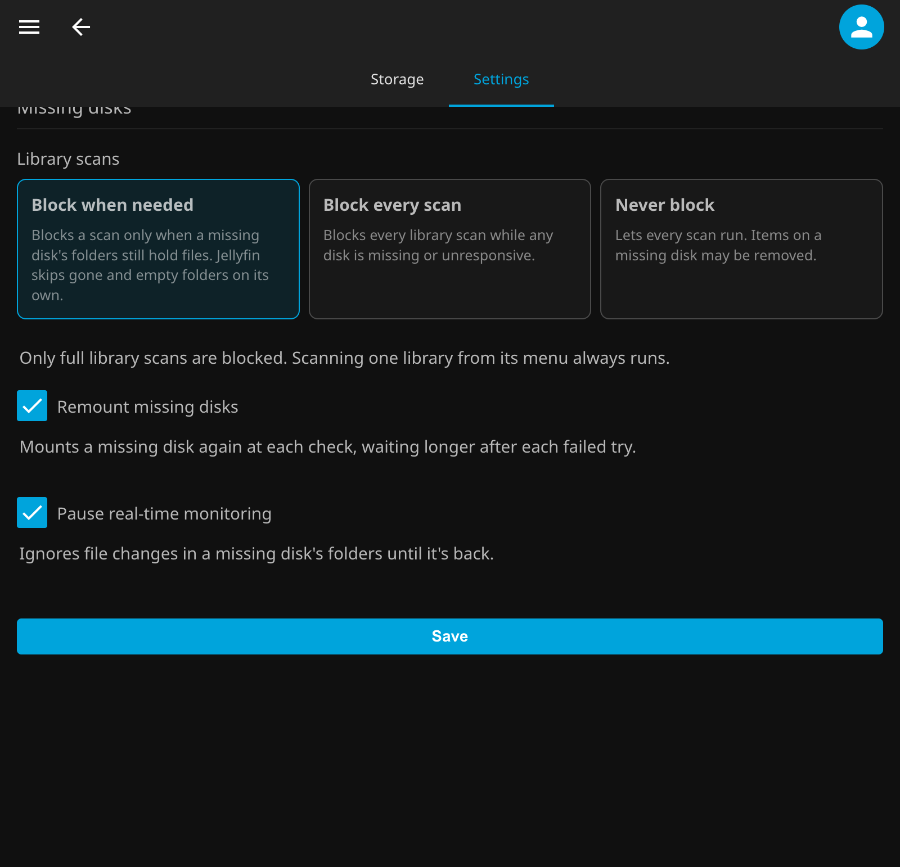

# Settings

The **Settings** tab sets the alerts every disk uses, and what Storage does while a disk is missing. Select **Save** to keep a change.

## Storage

The **Storage low** and **Storage full** alerts every disk uses, unless it has its own. See [Disk details](DiskDetails.md#alerts).

| Setting | What it does | Default |
| :--- | :--- | :--- |
| **Storage low** | Logs a warning in the activity log when a disk passes its point, and marks it **Low** | On, 90% used |
| **Storage full** | Logs an error in the activity log when a disk passes its point, and marks it **Full** | On, 95% used |
| **Measurement** | Sets the points as a share of each disk in use, **Usage**, or as the free space left, **Size** | **Usage** |

**Usage** runs from 50% to 100% used. **Size** runs from 2000 GB down to 10 GB free, in steps of 10 GB. **Storage full** always sits past **Storage low**, so a disk is low on space before it is full. Moving one slider into the other moves the other along.

A disk that passes an alert clears it only once it falls 2 points of its use below the point, so a disk that sits at the point is logged once.

## Health

The alerts a disk's SMART data can set off.

| Setting | What it does | Default |
| :--- | :--- | :--- |
| **Failing** | Logs an error when a disk's SMART data predicts it will fail | On |
| **Too hot** | Logs a warning when a disk runs past this temperature, from 40 °C to 80 °C | On, 60 °C |
| **Worn out** | Logs a warning when an SSD has used this much of its rated life, from 50% to 100% | On, 90% used |

A hot disk clears only once it is 5 °C cooler than the point. A disk that reports no SMART data sets off none of these.

## Missing disks

What Storage does while a disk Jellyfin uses is missing or unresponsive. See [Missing disks](MissingDisks.md).

| Setting | What it does | Default |
| :--- | :--- | :--- |
| **Library scans** | Sets when a full library scan is blocked | **Block when needed** |
| **Remount missing disks** | Mounts a missing disk again at each check, waiting longer after each failed try | On |
| **Pause real-time monitoring** | Ignores file changes in a missing disk's folders until it is back | On |

**Library scans** has three choices.

| Choice | What it does |
| :--- | :--- |
| **Block when needed** | Blocks a scan only when a missing disk's folders still hold files. Jellyfin skips gone and empty folders on its own. |
| **Block every scan** | Blocks every library scan while any disk is missing or unresponsive. |
| **Never block** | Lets every scan run. Items on a missing disk may be removed. |

Only full library scans are blocked. A scan of one library started from its menu always runs.

Next: [Missing disks](MissingDisks.md).
