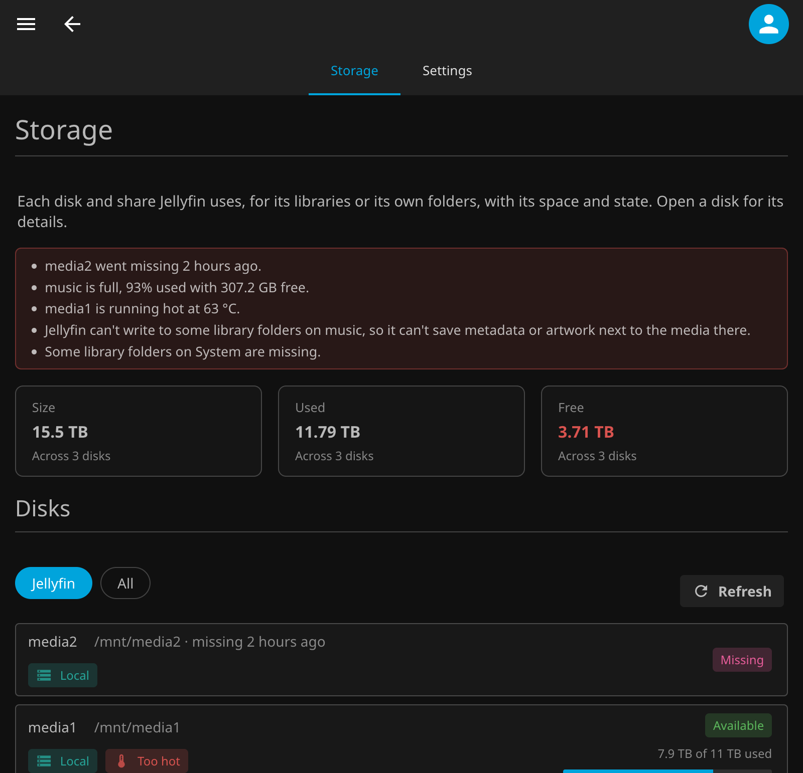
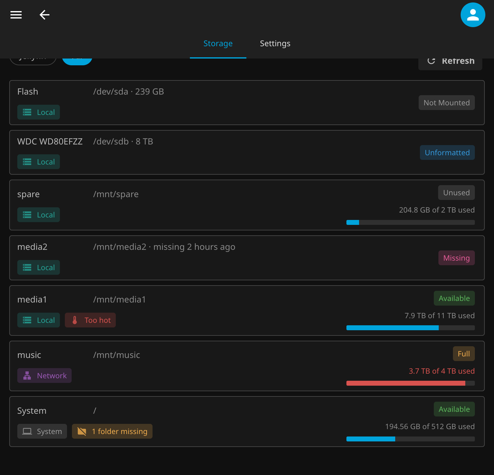
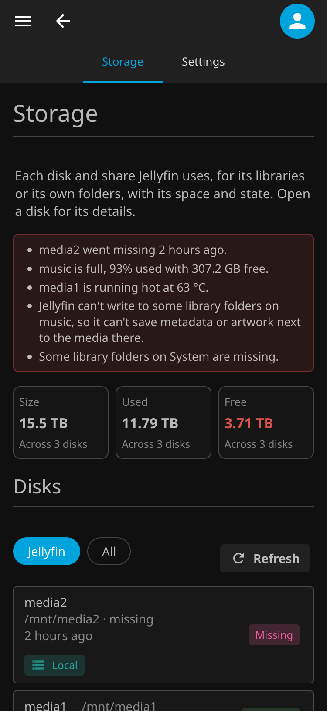
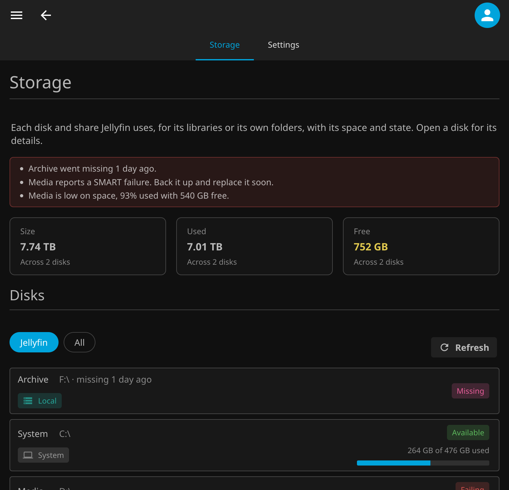

# Storage tab

Open **Storage** from the dashboard's side menu. The **Storage** tab shows what needs a look, how much space Jellyfin has, and every disk it uses.

## What needs a look

The banner at the top names each problem on a disk Jellyfin uses, one line each. It is red when any disk is missing, unresponsive, failing, or full, or when Jellyfin cannot write to one of its own folders. It is yellow for a disk that is low on space, too hot, or worn out, for library folders that are gone, and for library folders Jellyfin cannot write to. When nothing needs a look, it says every disk is healthy, in green.

## Space

The three cards add up the size, used space, and free space of every disk Jellyfin uses that could be read. The free space takes the color of the fullest disk's alert, green, yellow, or red.

## Disks

Each row is one disk or share. It shows the disk's name, its mount point, its type, its status, and a bar of its used space. The bar turns yellow and red at the disk's **Storage low** and **Storage full** alerts. Select a row to open the disk. See [Disk details](DiskDetails.md).

**Jellyfin** lists the disks that hold a library folder or one of Jellyfin's own folders. **All** also lists mounted disks Jellyfin does not use, disks with no file system, and on Linux, disks that hold data but are not mounted.

**Refresh** checks every disk again. Hover over it to see when the disks were last checked.

### Status

| Status | Meaning |
| :--- | :--- |
| **Available** | The disk is mounted and can be read. |
| **Low** | The disk is past its **Storage low** alert. |
| **Full** | The disk is past its **Storage full** alert. |
| **Failing** | The disk's SMART data predicts it will fail. |
| **Missing** | The disk is not mounted where Jellyfin expects it. |
| **Unresponsive** | The disk did not answer in time, as a dead share does. |
| **Unused** | The disk is mounted, but no library or Jellyfin folder is on it. |
| **Unformatted** | The disk has no file system, so it has no mount point. |
| **Not Mounted** | The disk holds data, but nothing on it is mounted. Linux only. |

### Tags

| Tag | Meaning |
| :--- | :--- |
| **System** | The disk the server runs from. |
| **Local** | A disk inside the server. |
| **External** | A disk plugged in from outside, such as over USB or Thunderbolt. |
| **Network** | A share reached over the network, such as SMB or NFS. |
| **1 folder missing** | A library folder is gone from the disk while it is mounted. |
| **Too hot** | The disk runs past the **Too hot** alert. |
| **Worn out** | The SSD is past the **Worn out** alert. |

## On a phone

The banner, the cards, and the rows stack to fit a phone.

{ width="375" }

## On Windows

Disks show by drive letter and volume label, and shares by their `\\server\share` path.

Next: [Disk details](DiskDetails.md).
