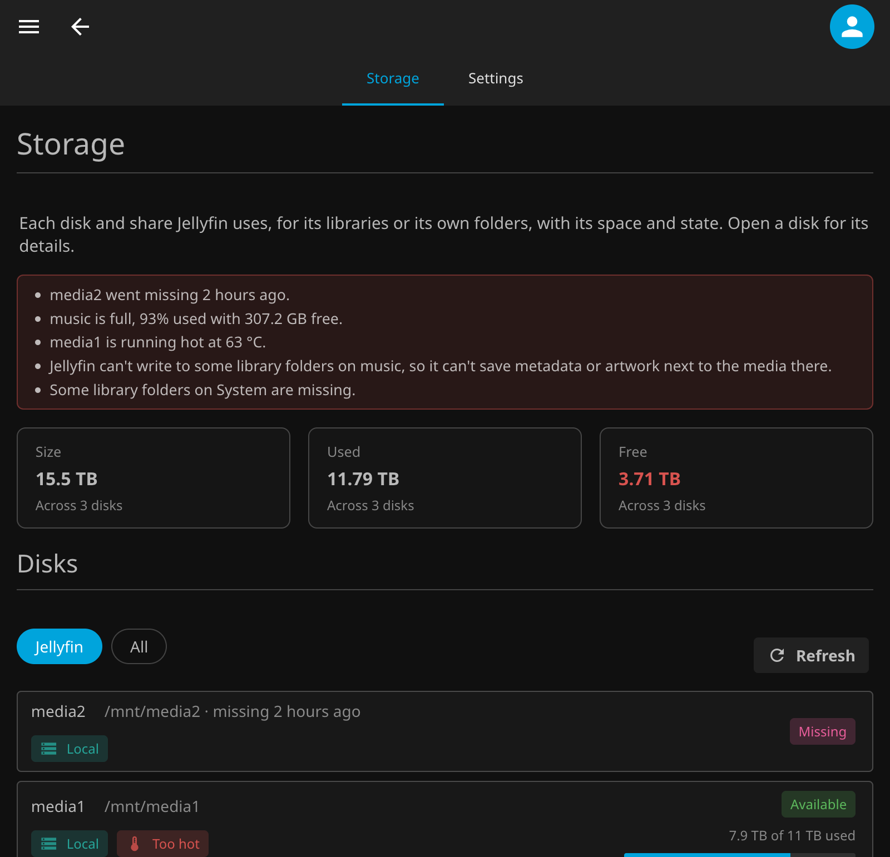

# Storage

{ width="160" }

Storage is a Jellyfin plugin that watches the disks and shares Jellyfin uses. It warns when a disk fills up, runs hot, wears out, or fails. It keeps library items safe while a disk is missing and mounts the disk again. It formats new disks and makes folders on them, ready for a library.

## What it does

* **Lists every disk Jellyfin uses.** Each disk and share that holds a library folder or one of Jellyfin's own folders, such as its cache and metadata, with its type, state, and space. See [Storage tab](StorageTab.md).
* **Says what needs a look.** A banner names each problem in one line, such as a missing disk or a full one, or says every disk is healthy.
* **Alerts on full disks.** **Storage low** and **Storage full** alerts log a warning and an error in the activity log. Each disk can have its own. See [Settings](Settings.md).
* **Alerts on disk health.** A disk whose SMART data predicts a failure, a disk running too hot, and a worn out SSD each log an entry.
* **Protects library items.** While a disk is missing, library scans that would remove its items are blocked, and real-time monitoring ignores its folders. See [Missing disks](MissingDisks.md).
* **Mounts missing disks again.** A dropped share or disk is mounted again the way its OS does, at each check.
* **Formats new disks.** A blank disk is formatted, mounted where it stays mounted after a restart, and added to a library in one step. See [Formatting and folders](Formatting.md).
* **Checks that Jellyfin can write.** A library folder or Jellyfin folder that Jellyfin cannot write to is flagged, before NFO files and artwork fail to save.
* **Logs every change.** Each change is written to the activity log once, in the server's language. See [Activity log](ActivityLog.md).

## How it works

The **Check storage** scheduled task checks every disk every 30 minutes and at startup. Opening the **Storage** tab or selecting **Refresh** checks them at once. Each check finds where every library folder and Jellyfin folder lives, reads each disk's space and SMART data, compares the result with the last check, and records what changed.

Everything runs inside Jellyfin, in C#, with the OS's own interfaces. The one exception is formatting on macOS, which uses Apple's `diskutil`, since macOS has no public interface for it.

## Platform support

| Feature | Linux | macOS | Windows |
| :--- | :--- | :--- | :--- |
| Disk list, space, and alerts | Yes | Yes | Yes |
| SMART health | ATA and NVMe through udisks2 | NVMe | NVMe, and failure prediction for others |
| Unformatted disks | Yes | Yes | Yes, as an administrator |
| Disks that hold data but are not mounted | Yes | No | No |
| Remount missing disks | Entries in `/etc/fstab` | Network shares | Network shares |
| Format disks | ext4, XFS, Btrfs, exFAT, NTFS through udisks2 | APFS and exFAT | NTFS and exFAT, as an administrator |
| Write check | Yes | Yes | No |

Some features need setup on the server. See [Installation](Installation.md).

!!! info "Docker"
    In a container, Storage sees only the folders mounted into the container. SMART health, formatting, and remounting need the host, so they do not work in Docker.

Next: [Installation](Installation.md).
